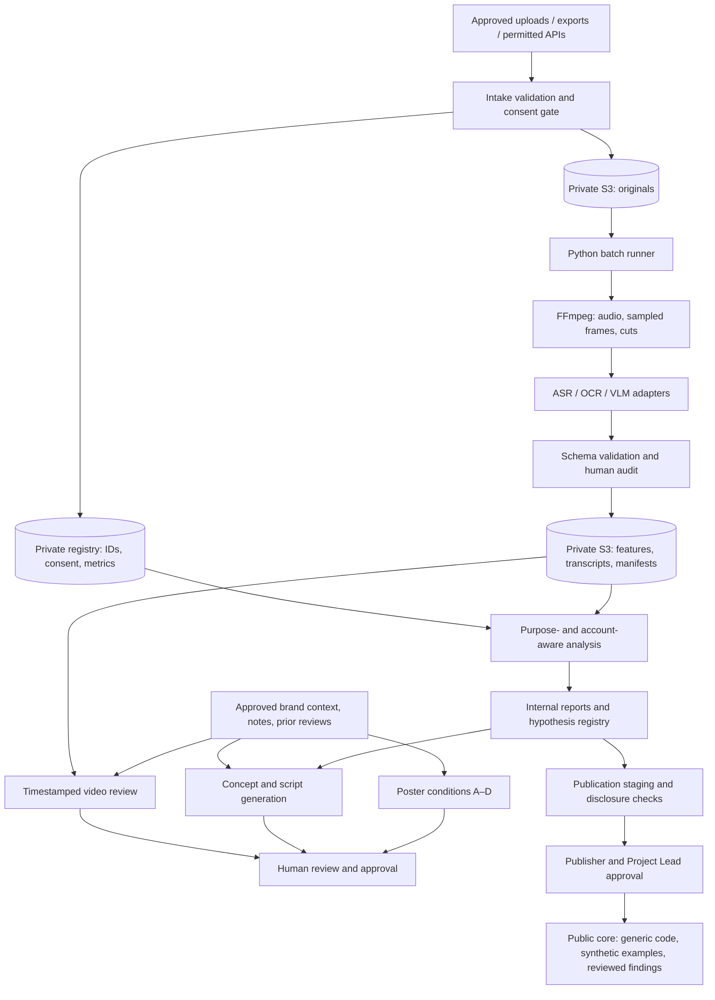

# JET Social Media Analysis — Architecture

Status: proposed architecture for the 10-week pilot; no implementation is implied.
Source: JET Social Media Analysis project proposal, Draft 1.0, September 16, 2026.
This document translates the proposal into an implementable design. Specific libraries, storage layouts, and execution contracts below are recommendations to confirm at kickoff.

## 1. Goals and boundaries

Support JET and consenting student organizations in understanding short-form content and improving production workflows. Start with Instagram Reels, 50–150 posts, and batch processing. Add TikTok only after the initial pipeline is validated.

Deliver:
- Structured video features and an internal analysis report.
- Timestamped AI video reviews.
- Meeting-notes-to-concept and 15–30 second script generation.
- A controlled poster-generation experiment.
- Reproducible evaluation and a reviewed, reusable public core.

Exclude real-time processing, large-scale scraping, face identification, inferred personal attributes, custom large-model training, and autonomous posting or replies. Person presence and movement may be tagged without identifying people. ASR speaker labels are local to a clip and must not establish identity.

## 2. System overview



All stores and processing paths before the publication gate are private. External model APIs are a separate trust boundary: only approved inputs may cross it. There is no automatic synchronization from private storage to the public repository.

## 3. Pilot technology choices

| Layer | Proposed implementation | Reason |
| --- | --- | --- |
| Intake | Validated CSV/JSON manifests and approved media upload | Fits a small pilot and owner-provided exports |
| Object storage | AWS S3 with encryption, blocked public access, least-privilege roles | Centralizes originals and derived artifacts |
| Processing | Python CLI, FFmpeg, provider-neutral ASR/OCR/VLM/LLM adapters | Batch execution with replaceable models |
| Contracts | Pydantic or JSON Schema, versioned schemas | Validates timestamps, labels, metrics, and model outputs |
| Analysis | pandas, Parquet, Jupyter, scipy/statsmodels, scikit-learn | Reproducible exploration and simple explanatory models |
| Internal interface | CLI and notebooks first; optional authenticated Streamlit UI | Keeps the initial scope and hosting costs small |
| State | Private run manifests and append-only audit events | Avoids a database service during the pilot |
| Reproducibility | Locked dependencies, Git revision, configuration and prompt hashes | Supports reruns by another member |

Use one controlled runner initially; do not allow concurrent writes to the same run manifest. Move to a database and job queue only if multiple operators or sustained concurrency require them. Do not provision always-on compute before measuring the 20-post trial.

Model providers remain undecided. Compare Japanese-language quality, timestamp accuracy, cost, terms, retention, training-use controls, and reproducibility on the same approved sample. Disable provider training use where supported and require acceptable retention terms before transmitting private data.

## 4. Public core / private data separation

**Public core, after approval:** generic extraction and evaluation code, schemas, sanitized configuration templates, synthetic fixtures, sample notebooks with synthetic outputs, and reviewed methodology.

**Private workspace:** original media, actual metrics, account mappings, consent records, meeting notes, brand assets, transcripts, prompts containing internal context, organization-specific findings, access configuration, and provider responses.

Suggested eventual public-core layout:

```text
ARCHITECTURE.md
src/jet_social/
  intake/          # Validation and generic import interfaces
  preprocessing/   # Audio, frame sampling, cut detection
  adapters/        # Provider interfaces; no credentials
  features/        # Timed labels and post-level aggregation
  review/          # Observation → impact → proposed edit
  planning/        # Concepts and scripts linked to hypotheses
  posters/         # A–D experiment runner
  analysis/        # Metrics, comparisons, baselines
  evaluation/      # Audit agreement and blinded human scoring
  governance/      # Export validation and deletion interfaces
schemas/
prompts/           # Generic templates only
configs/example.yaml
notebooks/         # Synthetic data and cleared outputs
tests/fixtures/    # Synthetic fixtures
docs/
```

Keep provider secrets, organization-specific connectors, populated manifests, internal paths, and actual context outside the public core. A private pilot repository is preferred until publication is approved. If this repository is public, add only material safe for public disclosure.

## 5. Private storage and data contracts

Suggested private storage zones: originals, derived artifacts, analysis outputs, publication staging, and separately permissioned identity/consent records. Use opaque IDs in object keys; never embed names or account handles. An opaque ID is pseudonymization, not proof of anonymization.

| Entity | Key fields and constraints |
| --- | --- |
| Consent record | consent_id, provider, approved purposes, model-processing permission, allowed users, expiry, withdrawal state |
| Post registry | post_id (random UUID), account_id (opaque), consent_id, platform, published_at with timezone, duration_ms, purpose, campaign_id, ad/collaboration flags, follower snapshot |
| Identity mapping | post_id/account_id to source URLs and owners; separately restricted |
| Metric snapshot | post_id, observed_at, measurement window, metric name, value, unit, source, availability, denominator definition |
| Feature event | post_id, start_ms, end_ms, feature type, value, confidence when supplied, source/model, schema version, human correction status |
| Analysis row | One row per post for a selected metric observation window, joined features and contextual covariates |
| Run manifest | run_id, input hashes, code revision, configuration/prompt/model versions, stage status, timestamps, usage, estimated cost |
| Review | post_id, run_id, evidence intervals, observation, likely impact, edit suggestion, uncertainty, human disposition |
| Experiment | hypothesis_id, condition, assignment method, outcome definition, observation window, confounders, results |
| Audit/release | actor, action, artifact reference, timestamp, review status and approvals |

Store JSON/JSONL for timed events and manifests; use Parquet for analysis snapshots. Keep content and metric snapshots separate until analysis. Missing or unavailable metrics must remain null with a reason, never zero-filled.

Define rates explicitly. For example, save rate = saves / reach only when reach is available and this denominator is chosen in advance. Record whether shares, profile visits, and follows use reach, plays, or another platform-defined denominator; do not mix definitions. Preserve platform definitions for completion and retention. Zero denominators produce null. Compare equivalent observation windows.

## 6. Batch processing contract

1. **Validate intake:** verify consent, supported format, file integrity, duration limits, metadata, and metric definitions. Reject or quarantine invalid inputs.
2. **Register:** generate opaque IDs, store originals privately, record hashes and provenance.
3. **Preprocess:** extract audio, sample frames around the first three seconds and later intervals, estimate cuts, and cap media sent to providers.
4. **Extract:** ASR produces timed text and local speaker labels; OCR produces timed screen text; VLM produces constrained labels for scenes, person presence, movement, framing, and objects. Use rules or specialist extraction for measurable audio/visual features where practical.
5. **Structure:** derive Hook/Value/Proof/CTA intervals, subtitle density, CTA count, pace, music/narration indicators, and post-level features. Link derived claims to timestamps or source events.
6. **Validate and audit:** validate output schemas and timestamp bounds; audit a stratified 10–20% of posts and record corrections and agreement.
7. **Analyze:** join validated features to a specified metric snapshot; generate purpose-specific baselines and hypothesis candidates.
8. **Generate support outputs:** use approved context and audited findings for review, planning, and poster experiments.
9. **Approve:** route drafts to humans; no social-platform publishing capability is included.

Persist each completed stage before advancing. Cache using input hash plus stage, model, prompt, schema, and configuration versions. Changed inputs or versions invalidate the affected stage and downstream outputs. Retry transient failures with bounded backoff; validation failures require correction. Failed posts remain visible and are excluded explicitly from affected analyses.

Treat uploaded media, OCR, transcripts, and meeting notes as untrusted content, never tool instructions. Model adapters cannot execute extracted commands or grant access to additional data.

## 7. Content-support workflows

### Video review

Supply the purpose, audience, brand guidelines, authorized prior outcomes, meeting notes, and prior critical reviews. Retrieve context only within the authorized organization; a simple curated context bundle is sufficient for the pilot.

Require structured output: timestamp range → observation → possible effect → concrete edit → evidence/uncertainty. Cover the opening three seconds, information overload, readability, potential drop-off points, and CTA clarity. Critique the artifact and decisions without personal attacks. Retention or causal claims must not be presented as observed facts unless the supporting data exists.

### Concepts and scripts

Extract purpose, audience, value proposition, constraints, deadline, and unresolved facts from approved notes. Produce concepts and 15–30 second scripts linked to a hypothesis and its evidence. Ask the human reviewer to resolve missing factual information before use. Keep generated drafts private.

### Poster experiment

Hold the model/version, output size, sample count per condition, and seed where supported constant. Log residual randomness.

| Condition | Context |
| --- | --- |
| A | Event name and date/time |
| B | A + audience, participation value, CTA |
| C | B + brand guidelines and authorized references |
| D | C + prior critical feedback and prohibited elements |

Blind and randomize human ratings for information accuracy, communication, brand consistency, usability, and safety. Verify event text, dates, logos, and rights before release. No fine-tuning is planned.

## 8. Analysis and evaluation

Start with medians, distributions, missingness, and outliers by purpose and account. Record posting time, account growth, audience size, paid promotion, collaborations, external events, and campaign context. Small observational samples support tentative associations; use prospective experiments to test actionable hypotheses.

Use simple linear or tree models only where sample size supports them. Fit preprocessing on training data only. Group repeated posts/campaigns or use time-aware splits to reduce leakage; for cross-account claims, evaluate held-out accounts where feasible. Never use outcome metrics as content features. Report effect sizes, uncertainty, sample sizes, and limitations; account for exploratory multiple comparisons.

| Goal from proposal | Measurement |
| --- | --- |
| At least 3 testable hypotheses | Hypothesis registry with evidence, confounders, and planned tests |
| 30% less production work | Comparable tasks timed before/after, including human correction time |
| At least 2 experiments | Predefined single-factor A/B or sequential comparisons with matched windows |
| Target +15% in a selected primary rate | Relative change from an agreed baseline; not a guaranteed outcome |
| Reproducibility | Another member reruns from instructions using authorized data or synthetic fixtures |
| Label quality | Human audit on 10–20%; report agreement by feature and correction rates |

Evaluate contextual AI reviews against generic prompts using blinded ratings for usefulness, specificity, brand fit, and safety. Use matched tasks and a shared rubric. The proposal's numeric targets remain provisional until kickoff baselines are confirmed.

Week 5 gate: aim for at least 50 posts, less than 20% missingness in the selected primary metric, and at least 80% audited label agreement. Define agreement calculations before auditing. Review per-label quality as well as aggregate agreement; shrink platforms, features, or research questions if the gate fails.

## 9. Access, retention, and release controls

- Data approvers authorize sources and purposes; engineers access processing inputs as needed; analysts receive pseudonymous analysis data; content reviewers receive only necessary media/context.
- Use role-based S3 access, encryption, blocked public access, short-lived credentials, and a managed secret store or protected runtime injection. Never commit secrets or real storage paths.
- Keep logs free of raw transcripts, prompts, personal details, and media. Restrict operational logs and consent/audit records.
- At kickoff define original/derived retention periods, provider retention, responsible deletion owner, access review cadence, and offboarding.
- Withdrawal blocks future processing immediately. Trace post IDs through originals, extracted media, caches, reviews, analysis exports, and provider-side artifacts; delete or recompute affected outputs as appropriate.
- Configure S3 lifecycle rules and explicitly cover object versions, backups, staging files, and local temporary files. Document deletion verification and provider limitations.
- Publication requires provider/account-owner consent and rights checks, re-identification review, removal of internal context and paths, and approval by both the publisher and Project Lead.
- Public releases use an explicit allowlist from staging. Check notebook outputs, image metadata, screenshots, small aggregates, prompts, Git history, and generated examples. Synthetic examples are the default.

## 10. Cost and operations

The proposal's CAD 150 Lean / CAD 425 Base caps cover the full 10-week pilot, not monthly spend.

| Category | Lean CAD | Base CAD |
| --- | ---: | ---: |
| S3 and transfer | 10 | 25 |
| ASR/OCR | 20 | 60 |
| VLM/LLM APIs | 70 | 200 |
| Image generation | 30 | 80 |
| Contingency | 20 | 60 |
| Total | 150 | 425 |

Benchmark 20 posts first. Record processed seconds, sampled frames, tokens, image count, retries, cache hits, currency conversion, and actual charges. Reconcile estimates with provider billing weekly. These caps are planning limits, not a pricing estimate; include compute/UI hosting or reduce scope before adding infrastructure costs.

Set per-run caps on duration, frames, tokens, retries, and image counts. Check estimated remaining budget before submission and stop new model calls at the selected cap; contingency use needs Lead approval. Review cost and participation at the Week 5 gate.

## 11. Implementation sequence and verification

| Period | Deliverable and acceptance |
| --- | --- |
| Week 1 | Roles, consent, access, retention, budget, and primary metric definitions agreed |
| Week 2 | Versioned schemas, label guide, 20-post intake and cost benchmark |
| Weeks 3–4 | Resumable extraction pipeline; 50 posts processed with provenance |
| Week 5 | Baselines, at least 3 hypotheses, quality/cost gate decision |
| Weeks 6–7 | Review and planning prototypes, poster conditions, blinded evaluation |
| Weeks 8–9 | At least 2 documented content experiments |
| Week 10 | Internal report, rerun by another member, reviewed release candidates, handover |

Before real-data processing, verify consent rejection, invalid/missing metrics, timestamp bounds, cache invalidation, bounded retries, partial-run recovery, and budget enforcement using synthetic fixtures. Verify least-privilege access and withdrawal/deletion on disposable private test objects. Ensure public notebooks run without private credentials and contain synthetic outputs only.

## 12. Decisions still required

1. Confirm Instagram Reels, participating organizations, available posts, and metric windows.
2. Name the Lead, data approvers, technical owner, analyst, and publisher.
3. Choose Lean or Base funding and approve actual provider prices/data terms.
4. Select deployment location, approved region, models, and data-processing boundaries.
5. Set retention periods, withdrawal procedures, and audit rubric.
6. Decide repository visibility and the timing of public-core publication.
7. Confirm baseline targets, experiment design, and post-pilot ownership.

The proposal recommends establishing data-use rules, the post schema, a 20-post processing sample, and measured costs before publishing reusable code. This architecture does not grant permission to publish private data or findings.
